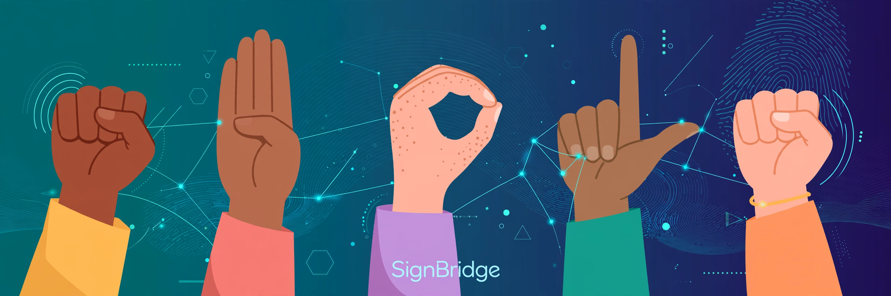
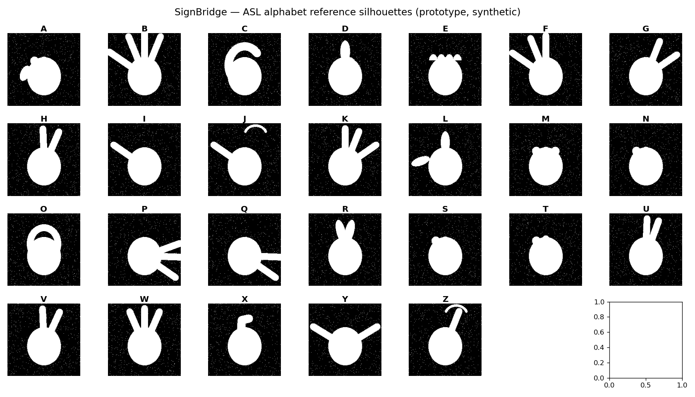
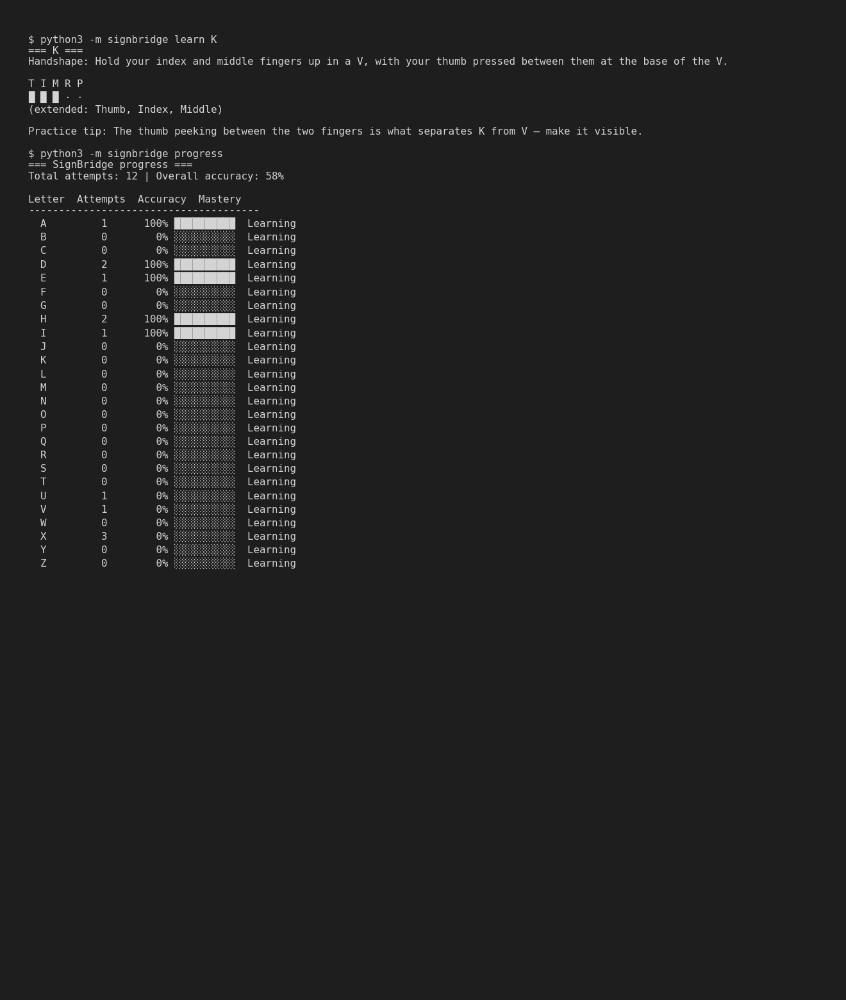
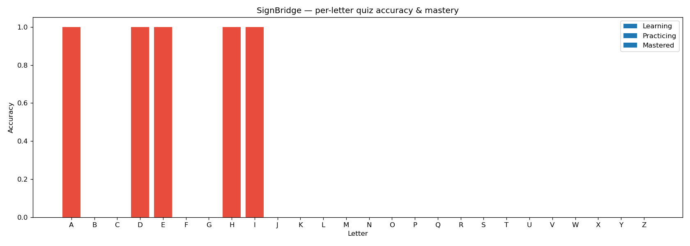

# 🤟 SignBridge




> **Learning ASL fingerspelling alone is hard. SignBridge is an interactive trainer that gives you instant feedback while you learn.**

## The Problem

American Sign Language fingerspelling is the gateway to signing — but most learners practice alone, staring at static charts, with no feedback loop. Apps that *do* give feedback require a camera, an account, and a cloud API, and they guess at your hands with black-box models. There is no simple, offline, honest tool that says: *"here's the alphabet, quiz me, track my progress."*

## The Solution

SignBridge is a **fully offline, zero-dependency-on-the-cloud ASL alphabet trainer**:

- 📖 **Learn** — browse all 26 letters with handshape descriptions, finger diagrams, and practice tips
- 🎯 **Quiz** — typed-answer quizzes with scoring and streaks (the reliable path: no fragile camera input)
- 🔬 **Prototype recognizer** — a from-scratch contour/shape-feature demo (Hu moments, convexity defects) with template matching, clearly framed as a *prototype stand-in*, not production hand tracking
- 📊 **Progress** — per-letter attempts, accuracy, and mastery levels persisted in SQLite

**Honesty note:** the recognizer works on *synthetic geometric silhouettes* generated programmatically — it demonstrates the *technique* (contour features + template matching) a real system would use. It does not claim to recognize real hands. See [Prototype vs. production](#-prototype-vs-production) below.

## Demo

Everything runs out of the box — no camera, no API keys, no network:

```bash
pip install -r requirements.txt

# Bundled demo: scripted quiz + recognizer self-check + regenerates the images below
python3 -m signbridge demo

# Browse the alphabet
python3 -m signbridge learn K

# Take a quiz (typed answers, streaks, saved to SQLite)
python3 -m signbridge quiz --rounds 10

# See your mastery
python3 -m signbridge progress

# Exercise the prototype recognizer
python3 -m signbridge recognize --self-test
```

### Screenshots (real outputs)

Reference grid generated from the synthetic silhouette engine:



CLI session — `learn` reference card and `progress` mastery table (actual terminal output):



Per-letter accuracy & mastery chart, generated from the SQLite progress DB after the bundled demo:



## Features

| Command | What it does |
|---|---|
| `learn [LETTER]` | Full alphabet or one letter: handshape description, finger-state diagram, practice tip |
| `quiz --rounds N --seed S` | Random handshape → you type the letter. Score, streaks, saved per-letter |
| `progress` | SQLite-backed mastery table (Learning / Practicing / Mastered) + accuracy bars |
| `recognize [--self-test]` | Prototype contour recognizer on synthetic silhouettes; 26/26 self-consistency |
| `demo` | One command that runs everything and regenerates `assets/` |

The dataset (`data/asl_alphabet.json`) holds all 26 letters, each with a handshape description, practice tip, extended-digit pattern, and shape class — validated by tests (exactly A–Z, in order, all fields present).

## 🧪 Prototype vs. Production

This is the honest part, and it matters:

- The "hand images" are **programmatic geometric silhouettes** (palm ellipse + finger-like protrusions), seeded per letter for determinism.
- Features are **hand-written, from scratch**: log-scaled Hu moments (7) + aspect ratio + extent + solidity + normalized convexity-defect count = an 11-D vector. No pretrained model, no training data.
- Matching is **nearest-template Euclidean distance**.
- Result: 26/26 self-consistency on its own templates — which proves the *pipeline* works, not that it recognizes real hands.

A production path would need: real hand datasets, skin/segmentation or MediaPipe landmarks, and a trained classifier. This prototype is the *scaffold* that path would hang on — and it's explicit about that everywhere, including the module docstring.

## Tech

- **Python 3** only (stdlib + `numpy`, `opencv-python-headless`, `matplotlib`)
- **SQLite** for progress tracking (`~/.signbridge/progress.db`)
- **pytest** — 21 real tests: dataset integrity (exactly 26 letters), quiz scoring math, feature extraction (11-D vector, blank-image edge case), recognizer self-consistency, DB updates & mastery thresholds
- 100% offline — no API keys, no network calls, reproducible with `--seed`

## Project Structure

```
signbridge/
├── README.md
├── LICENSE
├── requirements.txt
├── data/
│   └── asl_alphabet.json      # 26-letter ASL reference dataset
├── signbridge/
│   ├── cli.py                 # argparse: learn | quiz | progress | recognize | demo
│   ├── dataset.py             # dataset loading + validation
│   ├── learn.py               # reference browser + finger diagrams
│   ├── quiz.py                # typed-answer quiz, scoring, streaks
│   ├── progress.py            # SQLite tracking + mastery levels
│   ├── recognizer.py          # synthetic silhouettes + contour features + matching
│   ├── recognize.py           # `recognize` CLI
│   └── demo.py                # bundled demo (also regenerates assets/)
├── tests/                     # 21 pytest tests
└── assets/                    # hero.png, alphabet_grid.png, cli_screenshot.png, progress_chart.png
```

## Roadmap

- [ ] Timed & multiple-choice quiz modes
- [ ] Spaced-repetition scheduling (quiz weakest letters first)
- [ ] MediaPipe landmark pipeline as an *optional* real-hand input next to the prototype
- [ ] Confusion-matrix view ("you mix up M/N and U/V most")
- [ ] Export progress to CSV

## License

MIT — see [LICENSE](LICENSE).
